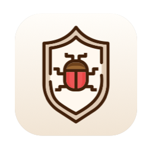

<p align="center">
  
</p>

<h1 align="center">MacScan</h1>

<p align="center">
  <strong>A free, open-source malware scanner and security checkup for your Mac.</strong><br>
  Runs only when you ask. Never deletes anything on its own.
</p>

<p align="center">
  <a href="https://github.com/mohammadmotallebi/MacScan/releases/latest"></a>
  
  
  <a href="https://github.com/mohammadmotallebi/MacScan/actions/workflows/ci.yml"></a>
  <a href="LICENSE"></a>
  <a href="https://buymeacoffee.com/mohamadmot5"></a>
</p>

---

MacScan is an **on-demand** malware scanner for your own Mac. By default it runs only when you open it and press a scan button: no launch agents, daemons, login items, menu bar helpers or system extensions. When you quit MacScan, every scan and helper process stops. Scheduled scans and scanning new downloads are optional and off by default (see [Background scans](#background-scans)).

- **ClamAV** signature scanning (via Homebrew's `clamscan`)
- **YARA** rules (via Homebrew's `yara`): a small sample macOS ruleset, your own rules, and **Apple's XProtect rules** that ship with macOS
- **App integrity**: `codesign --verify --deep --strict`, Gatekeeper/notarization (`spctl`), unsigned/ad-hoc executables, quarantine info
- **Signer checks**: flags **self-signed** apps and binaries (certificates Apple didn't issue, typical of cracked or repackaged software) and apps that **impersonate** a well-known publisher's bundle ID
- **Running Processes scan**: lists the programs running right now and flags untrusted ones (unsigned, self-signed, running as root, deleted program file, temporary or hidden location)
- **Browser Extensions scan**: lists the extensions of Chrome, Edge, Brave, Arc, Vivaldi, Opera, Firefox and Safari and flags sideloaded or very powerful ones
- **Security check**: shows whether macOS's own protections (SIP, Gatekeeper, FileVault, firewall, XProtect, updates, screen lock, sharing) are on, and looks for signs of tampering (hosts file, DNS, proxy, profiles, trusted certificates, sudo rules)
- **Privacy permissions**: shows which apps can use your camera, microphone, screen and files, and points out the ones worth a look
- **Network**: shows which programs are talking to other computers right now and which accept connections, and points out untrusted ones
- **Quarantine**: move a flagged item into a locked folder instead of the Trash, and restore it exactly where it was
- **Startup Items scan**: lists everything set to start automatically (launch agents and daemons, privileged helpers, shell startup files, plug-ins, cron) and flags risky ones
- **Optional VirusTotal hash lookup** with *your own* API key. Only SHA-256 hashes are sent, files are never uploaded.
- Results with severity filter, Reveal in Finder, Move to Trash (always asks first), Ignore
- Scan history with JSON and CSV export
- **Optional background scans**: a scheduled scan, and a scan of each new item in your Downloads folder, with a notification when something is found. macOS starts MacScan for each scan and MacScan exits afterwards, so nothing stays running.
- **Complete uninstaller**: removes an app together with its startup items, helpers, settings, caches, containers, logs and package-installed files, after you review a checklist. Everything goes to the Trash.

MacScan **never deletes or moves anything on its own.**

---

## Download & install

**Requirements:** macOS 26 Tahoe or newer, on an Apple Silicon or Intel Mac.
[Homebrew](https://brew.sh) is optional, for the ClamAV and YARA engines.

1. Download `MacScan-<version>.dmg` from the [Releases](../../releases/latest) page.
2. Open the DMG and drag **MacScan** onto the **Applications** folder.
3. Open MacScan from Applications. The first launch is blocked; see below.

### First launch: "Apple could not verify MacScan"

MacScan is free and isn't notarized by Apple, so macOS blocks it the first time. To allow it once:

1. Open MacScan and click **Done** (not "Move to Trash") on the warning.
2. Open **System Settings › Privacy & Security** and scroll down to Security.
3. Next to "MacScan was blocked…", click **Open Anyway** and confirm with your password or Touch ID.

On macOS 15 and newer, right-clicking the app and choosing Open no longer gets past this warning.
If you prefer the Terminal: `xattr -dr com.apple.quarantine /Applications/MacScan.app`

The downloads are ad-hoc signed: they carry no developer certificate, so macOS treats each new
version as a new app. After an update, turn **Full Disk Access** on again for MacScan ([step 2](#2-grant-full-disk-access)),
and allow Keychain access if it asks about your VirusTotal key. MacScan's own App integrity check
lists itself as ad-hoc signed for the same reason. Don't trust a binary? Build it yourself from
this source ([Build from source](#build-from-source)).

### Uninstall

Turn off any background scans in **Settings › Background** first, then quit MacScan and move
`/Applications/MacScan.app` to the Trash. Its data lives in `~/Library/Application Support/MacScan`.

## 1. Optional: install ClamAV and YARA

```sh
brew install clamav yara
```

You do **not** need to configure Homebrew's `freshclam.conf`. MacScan keeps its own database in
`~/Library/Application Support/MacScan/ClamAV` and downloads it only when you click
**Update virus database** (about 300 MB the first time). If you already maintain a database at
`/opt/homebrew/var/lib/clamav`, MacScan uses it automatically.

MacScan looks for the tools in `/opt/homebrew/bin`, `/usr/local/bin` and `/opt/local/bin`. You can set
custom paths in **Settings › Engines**.

## 2. Grant Full Disk Access

Without it, MacScan can still scan your Applications and most of your files, but macOS blocks
protected locations (Mail, Messages, Safari, other apps' containers). When that happens MacScan lists
the unreadable paths and walks you through this:

1. Open **System Settings › Privacy & Security › Full Disk Access**.
   (MacScan's *Open System Settings* button goes straight there.)
2. Click **+** and choose `/Applications/MacScan.app` (or drag it into the list).
3. Turn the switch **on**.
4. **Quit and reopen** MacScan.

Child processes MacScan starts (`clamscan`, `yara`, `codesign`) inherit its access.
For Desktop, Documents and Downloads, macOS may instead show a one-time consent prompt the first time you scan them.

## 3. First run

1. On the home screen, click the **Engines** card and then **Update virus database** (the first
   download takes a few minutes).
2. Click **Run Full Check**, pick one area under **Scan one area**, or drop any file or folder onto
   the window. The home screen shows how the last Full Check went, plus Security, Privacy, Network,
   Quarantine and Engines cards. **Over time** charts the threats, warnings and security score of
   your last 15 Full Checks; hover a bar for details, click it to open that check.
3. Review the results. Select a row for details. Right-click for Reveal in Finder, VirusTotal lookup,
   Ignore, or Move to Trash. Click **Home** to go back.

Expect some **Warnings** for legitimate software: ad-hoc signed open-source apps, older apps with an
obsolete signature format, apps whose bundle was modified by an updater, and so on. Each warning
explains what codesign or Gatekeeper actually reported, so you can judge it. Use **Ignore** to hide
a result you've reviewed. It reappears if the file's contents change.

---

## Settings

| Tab | What you can change |
| --- | --- |
| General | Menu bar icon, max file size, skip symlinks, "executables only" for Applications scans, excluded paths |
| Engines | Turn engines on/off, paths to `clamscan`/`freshclam`/`yara`/`yarac`, ClamAV DB folder, YARA rules folder |
| Background | Scheduled scan (daily or weekly, time, Full Check or Applications and Startup Items only), scan new downloads, notification status and test |
| VirusTotal | Your API key (stored in the login Keychain), auto-lookup of flagged files |
| Privacy | Full Disk Access status and instructions, log location |
| Ignored | Review and un-ignore hidden results |

### YARA rules

By default MacScan uses its bundled sample ruleset (Settings › Engines › *Show Sample Rules*).
These rules are deliberately small and heuristic, a starting point rather than a complete ruleset.
Point MacScan at your own folder to use more rules. Every `.yar`/`.yara` file in it (recursively) is
compiled together once per scan. MacScan reads two optional meta fields:

```yara
rule Example {
    meta:
        description = "Shown as the reason in the results list"
        severity    = "threat"   // or "warning" (default)
    strings:
        $a = "something"
    condition:
        $a
}
```

### Apple XProtect rules

macOS keeps its own malware YARA rules up to date at
`/Library/Apple/System/Library/CoreServices/XProtect.bundle/Contents/Resources/XProtect.yara`.
MacScan reads that file in place, in its own namespace, alongside your rules. A match is reported as a
**Threat** ("Apple XProtect: MACOS.xxxxxxx"). You can turn it off in Settings › Engines.

### Signer checks

Every app, and every Mach-O file inside it, is classified as Apple-issued, ad-hoc, **self-signed** or
unsigned. "Self-signed" means the certificate doesn't chain to Apple (`anchor apple generic`). Legitimate
developers don't ship that way; modified or cracked copies do, so it's reported as a **Threat**.

MacScan also knows the Team IDs of a few well-known publishers (Google, Microsoft, Zoom, Slack, Docker,
WhatsApp, Telegram, OpenAI, Valve, VideoLAN). An app that uses their bundle ID but is signed
by anyone else is reported as impersonation. The list is in `KnownPublishers` (`CodeSigning.swift`). Only
add Team IDs you've verified with `codesign -dv /Applications/<App>.app`.

Homebrew and MacPorts binaries are ad-hoc signed by design, so ad-hoc signing under `/opt/homebrew`,
`/usr/local/Cellar` and `/opt/local` isn't flagged. Self-signed binaries there still are.

Websites installed as apps from Chrome, Edge or Brave ("Chrome Apps" in `~/Applications`) are launchers
the browser builds and ad-hoc signs on your Mac. They use the browser's bundle ID without its Team ID by
design, so they get one Clean row ("Chrome web-app shortcut") instead of an impersonation Threat. A
launcher only counts when its bundle ID has the web-app form, it is ad-hoc signed, its seal is intact
and its only program is the browser's `app_mode_loader`. Anything else is judged like any other app.

### Full Check

**Full Check** (⇧⌘F) is one scan of everything MacScan can check without you choosing a folder:
Applications, Startup Items, Running Processes and Browser Extensions. It also reads the macOS
security settings (see Security check), the privacy permissions (see Privacy permissions) and takes a
network snapshot (see Network). Your saved folders are not part of it; use **Scan Folders**.

The result is a single list and a single History entry named "Full Check". Above the list there is
one tile per area with its threats and warnings, plus a Security Settings tile ("12 of 13 pass") and a
Privacy tile ("2 worth a look · 3 leftovers") and a Network tile ("Nothing odd · 29 programs"). Click an
area tile to show only that area's results; click it again to show everything. The Security Settings,
Privacy and Network tiles open their sections.

Under the tiles, **Since the last Full Check** lists what is different from the previous completed one:
new apps, apps that gained a sensitive permission (Screen Recording, Accessibility, Full Disk Access, Input
Monitoring, camera, microphone, Automation, App Management, Developer Tools), security or tampering checks
that got worse or whose finding changed (a new proxy, DNS server, certificate…), programs that now accept
connections from other computers (not macOS's own), and checks that are fixed now. The first Full Check only saves a starting point. A cancelled check is not compared and not saved, and
permissions are only compared when they could be read. The starting point is kept in
`fullcheck-baseline.json` in MacScan's folder.

An app that is also running or set to start at login is listed once under Applications; the running
program and the startup item keep their own rows in their areas. A Full Check takes as long as the
Applications scan (a few minutes with ClamAV and YARA on).

### Startup Items scan

**Scan Startup Items** (⇧⌘L) lists and checks:

| Location | What it is |
| --- | --- |
| `~/Library/LaunchAgents`, `/Library/LaunchAgents` | Programs started at login |
| `/Library/LaunchDaemons` | Programs started at boot **as root** |
| `/Library/PrivilegedHelperTools` | Root helpers (orphans included) |
| `~/.zshrc`, `~/.zprofile`, `~/.bash_profile`, … | Commands run in every Terminal shell |
| Quick Look, Spotlight, scripting additions, authorization plug-ins, input managers, kexts | Code macOS loads automatically |
| Your `crontab` | Scheduled jobs |

Each item gets a row (Clean if nothing's wrong). Each referenced program also goes through ClamAV, YARA and
the integrity checks. Items are flagged when they:
- run as root with an unsigned or self-signed program (**Threat**), or with an ad-hoc one
- point to a missing program, or one in `/tmp`, `/Users/Shared` or a hidden folder
- download-and-run, decode base64, open raw sockets, run inline AppleScript/Python, or strip quarantine
- impersonate a known publisher

Nothing is disabled or deleted. Use **Reveal in Finder** and remove items yourself if you decide to.

**What changed since the last scan.** Every Startup Items scan (including the scheduled one) is compared
with the previous one. Items that were added, or that now start a different program, use different
arguments, have a different signer or (for scripts and shell files) different contents, get a **NEW** or
**CHANGED** badge, and the details say what changed. A **New or changed** checkbox above the results shows
only those, and the scan notes also list removed items. An app update that replaces a program with one from
the same signer doesn't count as a change. The first scan only saves the baseline. A scheduled scan sends a
notification when items were added or changed, even if nothing about them is flagged.
Login items you manage in System Settings › General › Login Items, and configuration profiles, need admin
rights to list. Review them in System Settings.

### Running Processes scan

**Scan Running Processes** (⇧⌘P) looks at every process that is running right now and lists one row per
program (a browser's twenty helper processes are one row), with its process IDs, user, parent and signature.

Programs are flagged when they:
- run as root without a trusted signature (**Threat**), or with an ad-hoc one
- are self-signed (**Threat**) or not signed at all
- have no Apple-issued signature and run from `/tmp`, `/Users/Shared`, Downloads or a hidden folder
- were started from a file that has since been deleted (an app updated while running is recognised and
  shown as Clean)
- impersonate a known publisher

Each program file also goes through ClamAV, YARA and the integrity checks, like any scanned file. Apple
system software on the sealed system volume is counted in the scan notes but not listed. Signed programs
aren't flagged for their location, because macOS itself runs signed apps from temporary folders (App
Translocation, code-sign clones, iPhone app wrappers).

Nothing is stopped, suspended or changed. Quit a program yourself in Activity Monitor if you don't trust it.
This is a snapshot of the moment you scan, not live monitoring.

### Browser Extensions scan

**Scan Browser Extensions** (⇧⌘E) lists one row per extension in Chrome (including Beta and Canary),
Chromium, Edge, Brave, Arc, Vivaldi, Opera, Firefox and Safari, for every profile, with its version, whether
it is enabled, where it was installed from, which websites it can access and its permissions.

Extensions are flagged (**Warning**) when they:
- were not installed from the browser's store: loaded from a local folder, added by another program,
  force-installed by a policy, or (Firefox) not signed by Mozilla
- are enabled, can read and change **all websites**, and also hold a sensitive permission (cookies, history,
  native messaging, debugger, proxy, managing other extensions, network requests, clipboard, privacy settings)
- (Safari) belong to an app that isn't signed by a trusted developer

Ad blockers and password managers legitimately need that much access, so expect a warning for them the first
time; choose **Ignore** for the ones you trust. Each extension's files also go through ClamAV and YARA, and a
hit inside an extension is reported under that extension. Like Startup Items, each scan is compared with the
previous one: new extensions and ones that gained permissions or website access get a **NEW** or **CHANGED**
badge. An ordinary version update is not a change.

Nothing is disabled or removed; do that in the browser's own extension settings. For Safari, macOS reveals
what an extension may ask for, not which websites you allowed. Browsers built into the system (components) and
Firefox themes are not listed.

### Security check

**Security** in the sidebar (⇧⌘K) shows whether the protections built into macOS are on. Each row is a pass,
a warning or a fail, with one line on what it means and how to fix it:

| Check | Not passing when |
| --- | --- |
| System Integrity Protection | off (**Fail**) or a custom configuration |
| Gatekeeper | off (**Fail**) |
| FileVault disk encryption | off |
| Firewall | off |
| XProtect malware definitions | not updated for more than 60 days |
| macOS updates | updates are waiting (as of macOS's last check; MacScan doesn't go online for this) |
| Automatic security updates | checking, or installing Security Responses and system files, is turned off |
| Password after sleep or screen saver | off, or a delay over 15 minutes |
| Automatic login, Guest account | on |
| Remote Login (SSH), Screen Sharing, File Sharing | on |

A second group, **Signs of tampering**, looks for settings adware and malware change to redirect or watch
your traffic:

| Check | Not passing when |
| --- | --- |
| Hosts file | well-known sites (Apple, Google, banks, crypto exchanges…) are sent to another address (**Fail**), Apple's security servers are blocked, or other names point elsewhere. Names pointed at this Mac (blocking or local development) pass |
| DNS servers | a server isn't local, your router, or a well-known service (Google, Cloudflare, Quad9, OpenDNS, AdGuard, NextDNS…) |
| Web proxy | a web, secure web or SOCKS proxy, or an automatic proxy file, is set |
| Configuration profiles | a profile is installed for your account (profiles for the whole Mac need an administrator to list) |
| Trusted certificates | a root certificate was added and marked as trusted. Ones from development tools (mkcert, Laravel Valet, Herd…) pass with a note; debugging proxies (Charles, mitmproxy…) don't |
| Extra administrator rules | files in `/etc/sudoers.d`. Ones from development tools (Herd, Valet…) pass with a note |

MacScan only reads these settings with the system's own status tools and never changes one; **Open Settings**
takes you to the right pane. It needs no administrator password. A setting that can't be read is shown as
unknown, never as a pass.

### Privacy permissions

**Privacy** in the sidebar (⇧⌘Y) lists which apps macOS has allowed or denied for each permission: Camera,
Microphone, Screen Recording, Accessibility, Input Monitoring, Full Disk Access, Automation, Files and
Folders, Contacts, Calendar, Reminders, Photos, App Management and Developer Tools. Each row shows the app
and who signed it.

| Mark | When |
| --- | --- |
| **Warning** | an allowed app is unsigned, ad-hoc signed or self-signed (more so when it runs from Downloads, a temporary or a hidden folder) |
| Worth a look | the app can't be found (a leftover if you removed it), its signature can't be read, or it can both record the screen and control the Mac |

Denied apps are never marked. Homebrew/MacPorts builds and browser web-app shortcuts are not marked for
being ad-hoc signed. **Flagged only** hides everything else.

When an app is no longer installed, its row has a **Remove…** button, and **Remove Leftovers…** removes
all of them after you confirm. MacScan uses macOS's own `tccutil reset` for this. That tool refuses an app it
can't find, so MacScan makes a tiny stand-in app with the same ID in its own folder, runs the reset, and
deletes the stand-in again. Permissions of installed apps are never touched.

MacScan needs Full Disk Access to read the list, because macOS keeps it private. It reads a private copy of
macOS's two permission databases and never edits them; **Open Settings** takes you to the right
page. Location Services is not listed (macOS keeps it in a file only root can read).

### Network

**Network** in the sidebar (⇧⌘N) is a snapshot of which programs have network connections open right now,
taken with macOS's own `lsof`. One row per app (its helpers included) or program, with where it connects
(this Mac, the local network or the internet) and which ports it listens on. Click the arrow for the
addresses and ports.

| Mark | When |
| --- | --- |
| **Warning** | an unsigned, ad-hoc signed or self-signed program talks to other computers or accepts connections from them (more so from Downloads, a temporary or a hidden folder) |
| Worth a look | a TCP port is open to other computers, it connects to a port remote shells and backdoors often use (such as 4444 or 31337), its program file can't be found, or it was replaced while running |

macOS's own programs are hidden unless something about them is worth a look (**Hide macOS**). Homebrew and
MacPorts builds aren't marked for being ad-hoc signed. UDP ports open on all interfaces are listed but not
marked; they are mostly local discovery such as Bonjour.

MacScan never blocks or closes anything, and it doesn't look up host names, so the check never goes online.
Without administrator rights only your own programs are visible.


### Install

**Install** in the sidebar (⇧⌘I) checks an app before it goes into Applications. Drop a `.dmg`, `.zip`,
`.app` or `.pkg` onto it, choose one, or pick a recent download.

1. MacScan opens it without running anything: disk images are mounted read-only and hidden, zips and
   packages are unpacked into a temporary folder.
2. Every app inside is scanned (ClamAV, YARA, signature, notarization, VirusTotal if set up). The card shows
   who signed it, whether macOS would allow it, the version, and what it carries inside (helpers that run as
   administrator, background agents, login items, system extensions).
3. It's compared with the copy you have: update or older, and above all **signed by a different developer**,
   the sign of a fake update.
4. **Install** (or **Replace**) copies it into /Applications after you agree. The old copy goes to the Trash.
   A running app must quit first. The password is asked only when needed. The download flag stays on, so
   Gatekeeper still checks the app when it first opens. Flagged apps need **Install Anyway…** and a second yes.
5. For a `.pkg`, MacScan shows its signature and its install scripts (they run as administrator) and flags
   scripts that download things or add startup items. **Open in Installer** hands it to Apple's Installer;
   MacScan never runs a package itself.

The check is saved to History as "Install check: <file>". Afterwards MacScan can move the installer to the Trash.

### Disk Usage

**Disk Usage** in the sidebar (⇧⌘D) measures a folder and lists its largest files and folders, with a
Cleanup tab of things that are usually safe to remove. Select several rows with ⌘-click or ⇧-click: a bar
shows how many and how big, with one **Move to Trash…** and one confirmation. Right-click works on the
whole selection. System and standard folders (Downloads, Documents, …) are never moved.

### Battery

**Battery** in the sidebar (⇧⌘B) shows which apps and services use energy. MacScan only looks; it never
quits or slows anything.

- **Using energy now**: Activity Monitor's energy number, measured over 2 seconds. An app's helpers count
  toward the app (Code Helper toward VS Code). Each row is tagged High, Medium or Low, and busy macOS
  services get a short note, e.g. "Spotlight indexing your files".
- **Most energy since opened**: watt-hours each of your own apps used since it started (Apple silicon).
  macOS doesn't share this for its own services or other users' programs.
- **Keeping your Mac awake**: what stops the Mac or its screen from sleeping (from `pmset -g assertions`).
  Audio held by macOS for an app is shown under that app.
- macOS helpers count for the app that started them: Docker's virtual machine shows as Docker.
- **Live** re-measures every 5 seconds while the section is open.
- The header shows charge and whether the Mac is on battery. The home screen has a Battery card.

### Quarantine

Every scan result has **Quarantine…** next to **Move to Trash…**. After you confirm, the item is moved into
MacScan's quarantine folder and locked (all permissions removed), so it can't run, be opened or be indexed.

The **Quarantine** section in the sidebar lists what is there, with where it came from, why it was flagged
and its SHA-256. From there you can:
- **Restore** an item to exactly where it was, with its original permissions. Restore refuses to overwrite
  something that has since appeared at that path.
- **Delete Permanently…** one item, or **Delete All…**. This asks first and can't be undone.

MacScan never quarantines, restores or deletes anything by itself. System locations can't be quarantined, and
items owned by another user or protected by macOS are refused with an explanation. Scans skip the quarantine
folder.

### Uninstall

**Uninstall** in the sidebar (⇧⌘U), or **Uninstall App…** on any scan result inside an app:

1. Pick an app from the list, choose one, or drop a `.app` onto the window.
2. MacScan lists everything that belongs to it, grouped by type, with sizes:
   - the app bundle
   - LaunchAgents/LaunchDaemons that are named after the app, declare it as owner, or start a program inside it
   - privileged helpers those items start
   - `~/Library` and `/Library` items named after the app's bundle ID, or a helper/extension ID inside it: Application Support, Caches, Preferences (incl. ByHost), Containers, Group Containers, Logs, Saved State, HTTPStorages/WebKit/Cookies, Application Scripts
   - folders with exactly the app's name (marked **name match**; check them)
   - files its `.pkg` installer put elsewhere (from `pkgutil` receipts)
   - its running processes
   - its **registered background items** from macOS's Background Task Management database (`sfltool dumpbtm`):
     helpers and login items embedded in the bundle (SMAppService), and legacy agents/daemons, even when
     they're named differently (e.g. Steam's `com.valvesoftware.steamclean`)
   - launch items that start a program from one of the app's support folders
3. Untick anything you want to keep. Items shared with the same developer's other apps (e.g. a common
   updater) are marked **shared?** and are *not* ticked by default. Then click **Uninstall…** and confirm.

MacScan then:
- quits the app
- stops **and unregisters** its background items (`launchctl bootout`, by plist and by label, which also
  covers helpers embedded in the bundle)
- moves the selected items to the **Trash**
- forgets its installer receipts

System-owned items need your administrator password: macOS asks once for all of them. Those items also go to your Trash, but without Finder's "Put Back". Nothing is permanently deleted until you empty the Trash. Apps that are part of macOS, protected by SIP, or MacScan itself can't be uninstalled.

**Trash vs. permanent:** macOS keeps listing an app's background items in System Settings › General ›
Login Items & Extensions **while the app is still in the Trash**. To make them disappear:
- tick **Delete permanently** before uninstalling, or
- use the **In the Trash** group in the app list to finish off apps you've already moved to the Trash.
  Items already in the Trash are deleted permanently, and the confirmation says so.

**Apps you already deleted:** the **Probably Removed** group lists apps that are gone but left files in your
Library (Application Support, Preferences, Caches, Containers, Logs, Saved Application State, HTTPStorages,
WebKit), biggest first. An item counts when it's named like an app ID (`com.vendor.App`) and macOS knows
no app with that ID. Apple's items, helpers of installed apps and tool caches are skipped. Select one to see
its files, the same as **Already Removed App…** (where you can also type a bundle ID or name yourself).
Check each item before removing it.

Whatever the list says, MacScan refuses to remove top-level or system locations (`/Applications`, `/Library`,
`~/Library/…` roots, `/System`, `/usr`, …).

### Background scans

The scheduled scan and the Downloads watcher are in *Settings › Background* and are off by default.
The two live-protection watchers below are on by default.

- **Scan on a schedule** runs a **Full Check** (plus your scan folders) every day or every week at the
  time you pick, and compares it with the last Full Check. Set "What to scan" to *Applications and Startup
  Items only* for the older, smaller scan.
- **Alert on new startup items** (on by default) runs a Startup Items scan whenever something changes in
  `~/Library/LaunchAgents`, `/Library/LaunchAgents` or `/Library/LaunchDaemons`, and tells you about items
  that are new or changed since the last check ("New startup item: com.foo.updater", with what it runs or
  who signed it). MacScan's own agents don't count. Scans that find nothing new aren't saved.
- **Scan new apps** (on by default) scans apps that arrive in `/Applications` or `~/Applications` once
  they stop changing. You only get a notification when something is flagged. The apps already there when
  it's turned on are marked as seen (`apps-seen-*.json`).
- **Alert when an app drains the battery** (on by default) checks energy use every 5 minutes, only while
  on battery. An app (not macOS) that stays High for 15 minutes gets one notification, at most once a day
  per app ("Motrix has been using a lot of energy for 15 min."). Clicking it opens Battery.
- **Scan new downloads** scans each new item that arrives in `~/Downloads`. Items that were already there
  when you turned it on are not scanned, and unfinished downloads (`.crdownload`, `.download`, `.part`)
  wait until they are complete.

**Status.** The top of *Settings › Background* shows each agent: Active, Off or Not loaded (with a Fix
button that reinstalls MacScan's own agent), when it last ran and what it found ("Nothing new", "Scanned
Zoom.app: no issues"), when the scheduled scan runs next, and an Open button for the last saved scan.
Every run is noted in `background-status.json`, including quiet ones that aren't kept in History.

How it works: MacScan installs its own per-user launch agents in `~/Library/LaunchAgents`
(`com.local.MacScan.scheduled-scan.plist`, `com.local.MacScan.downloads-watcher.plist`,
`com.local.MacScan.startup-watcher.plist`, `com.local.MacScan.apps-watcher.plist`). launchd starts the
MacScan executable in a headless mode (`--macscan-background-scan`) when a scan is due, and it exits when
the scan ends. No MacScan process stays running in between. Turning an option off unloads and deletes
its agent.

- Every background scan is saved in History, marked *Scheduled* or *New downloads*. Of the background
  scans that found nothing, only the 10 newest per kind are kept.
- You get a notification only when something new is flagged, or when a scheduled Full Check finds changes
  since the last Full Check ("Full Check: 2 changes since the last check · Firewall changed · Zoom: now uses
  Screen Recording"). Fixes alone and known results don't notify again. Click the notification to open
  the scan in History.
- A scheduled Full Check reads the security settings and permissions as you. Without Full Disk Access the
  permissions can't be read, so they aren't compared.
- Background scans never run as administrator and never move or delete anything.
- Scheduled scans run while you're logged in. A scan missed while the Mac was asleep runs after it wakes;
  one missed while the Mac was off or you were logged out is skipped.
- While an option is on, MacScan appears in System Settings › General › Login Items and in its own
  Startup Items scan (labelled as MacScan's own agent).

**New permissions.** *Settings › Background › "Tell me when an app gets a sensitive permission"* is on by
default. While MacScan runs (it stays in the menu bar), it reads the permission list every 5 minutes and
sends a notification when an app gets the camera, microphone, screen recording, Accessibility, Input
Monitoring or Full Disk Access, e.g. "Zoom can now use your camera". Click it to open Privacy. The first read
only saves a starting point (`permission-watch.json`). It needs Full Disk Access and only reads the list.
- The agents point at the copy of MacScan that turned them on. If you move the app, open it once and
  MacScan repairs them.

### Menu bar icon

On by default. Turn it off in Settings › General › *Show MacScan in the menu bar*; then closing
the window quits MacScan as before.

- The icon is a one-color version of MacScan's icon (a shield with a bug). A small mark in its corner
  shows the last Full Check: none when nothing needs attention, an "!" for warnings, settings that
  are off, risky permissions or new changes, a filled "!" for threats, and "…" while a scan runs.
- Its menu shows the last result in plain words (click it to open that result), and can start a
  Full Check, check security settings or network activity, open MacScan or its settings, and quit.
- While it's on, closing the window keeps MacScan running in the menu bar without a Dock icon.
  Only *Quit MacScan* (in that menu, or ⌘Q) closes it. A background scan that finishes updates the icon.

### VirusTotal

Free keys allow 4 lookups per minute and 500 per day, so MacScan spaces requests 15 s apart.
By default nothing is looked up automatically. Use the per-result *Look Up Hash on VirusTotal* action,
or turn on auto-lookup for flagged files only.

## Where MacScan keeps things

| What | Where |
| --- | --- |
| Log | `~/Library/Logs/MacScan/MacScan.log` (rotated at 5 MB) |
| Scan history (JSON, last 100 scans) | `~/Library/Application Support/MacScan/History/` |
| Ignore list | `~/Library/Application Support/MacScan/ignored.json` |
| Downloads already seen (only with "Scan new downloads") | `~/Library/Application Support/MacScan/downloads-seen.json` |
| Quarantined items | `~/Library/Application Support/MacScan/Quarantine/` |
| Startup items of the last scan (to report changes) | `~/Library/Application Support/MacScan/startup-baseline.json` |
| Browser extensions of the last scan (to report changes) | `~/Library/Application Support/MacScan/extensions-baseline.json` |
| Launch agents (only while background scans are on) | `~/Library/LaunchAgents/com.local.MacScan.*.plist` |
| ClamAV database + `freshclam.conf` | `~/Library/Application Support/MacScan/` |
| Settings and folder list | `defaults read com.local.MacScan` |
| VirusTotal key | Login Keychain, service `MacScan.VirusTotal` |

**Uninstall:** delete `MacScan.app`, the two folders above, run
`defaults delete com.local.MacScan`, and remove the `MacScan.VirusTotal` Keychain item.
If background scans are on, turn them off in *Settings › Background* first so MacScan removes its launch
agents. Otherwise there is nothing else to remove.

---

## Development

### Build from source

Requirements: macOS 26 and Xcode 27 or newer (the menu bar code uses the macOS 27 SDK).
See [CONTRIBUTING.md](CONTRIBUTING.md) for guidelines.

1. Open `MacScan.xcodeproj` in Xcode.
2. Select the **MacScan** target › **Signing & Capabilities**.
3. Keep **Automatically manage signing** on and choose your **Personal Team** under *Team*.
4. If Xcode says the bundle identifier is unavailable, change `com.local.MacScan` to something unique,
   e.g. `com.<yourname>.MacScan`.
5. Press **⌘R** to build and run.

MacScan uses **no App Sandbox and no restricted entitlements** (only the Hardened Runtime), so a free
personal team is enough.

#### Install your build in /Applications

Full Disk Access is granted per app, and the copy Xcode runs lives deep inside DerivedData. To get a
stable copy, use **Product › Show Build Folder in Finder** › `Products/Debug/MacScan.app` and drag it to
`/Applications`. Or build Release from the command line:

```sh
xcodebuild -project MacScan.xcodeproj -scheme MacScan -configuration Release \
  -derivedDataPath build DEVELOPMENT_TEAM=<YOUR_TEAM_ID> build
cp -R build/Build/Products/Release/MacScan.app /Applications/
```

(Your team ID is shown in Xcode › Settings › Accounts, or in the *Team* field of the project.)

Keep signing with the same team and bundle identifier. macOS then recognizes rebuilt copies as the
same app, and Full Disk Access and the Keychain item keep working.

### Release builds

```sh
scripts/release.sh   # universal Release build, ad-hoc signed, Hardened Runtime → build/MacScan-<version>.dmg
```

With `DEVELOPER_ID=<identity>` it signs with a Developer ID certificate instead, and with
`NOTARY_PROFILE=<profile>` it also notarizes and staples the DMG. The version comes from
`MARKETING_VERSION` in the Xcode project.

### Project layout

```
MacScan.xcodeproj
MacScan/                      SwiftUI app (thin UI layer)
  MacScanApp.swift            Window + Settings scenes; kills child processes on quit
  AppState.swift              @Observable state, user actions (scan, trash, ignore, export…)
  BackgroundNotifications.swift  Notification Center delivery and click handling for background scans
  Views/                      Main screen, results, history, settings, sheets
Config/MacScan.entitlements   App Sandbox explicitly OFF
Packages/MacScanCore/         All scanning logic (Swift package, testable with `swift test`)
  Sources/MacScanCore/
    Engines/                  ScanEngine protocol, ClamAV, YARA (+XProtect), AppIntegrity, VirusTotal, CodeSigning/KnownPublishers
    Security/                 SecurityPosture (status of macOS's own protections)
    Privacy/                  PrivacyAudit (which apps have which privacy permissions)
    Network/                  NetworkScanner (which programs use the network right now)
    Scanning/                 FileEnumerator, Persistence (startup items), StartupChanges, RunningProcesses, BrowserExtensions, Mach-O detection, ScanCoordinator
    Background/               BackgroundAgent (launchd plists), DownloadsTracker, BackgroundScanWorker (headless mode)
    Support/                  ProcessRunner (cancellable), ToolLocator, FileLogger, Keychain, hashing
    Persistence/              History, ignore list, folder bookmarks, Full Disk Access helpers
    Export/                   JSON / CSV export
    Uninstall/                InstalledApp, LeftoverFinder (what belongs to an app), Uninstaller (quit, bootout, Trash, admin step)
    Resources/SampleRules/    Bundled YARA rules
  Tests/MacScanCoreTests/     Swift Testing unit tests
```

### Running the tests

```sh
cd Packages/MacScanCore
swift test
```

Or select the **MacScanCore** scheme in Xcode and press **⌘U**.

- ClamAV tests use the **EICAR** test string against a tiny generated signature database, so they
  don't need the official download. An extra test also checks EICAR against the official database
  once you've clicked *Update virus database*. ClamAV/YARA tests skip themselves if the tools are missing.
- The VirusTotal tests use a mocked network layer and never contact VirusTotal.
- Signer tests create a throwaway self-signed identity in a private temporary keychain (never added to
  your keychain search list).
- Opt-in smoke tests against your real system (read-only):
  `MACSCAN_REAL_PROBE=/tmp/probe.txt swift test --filter realApplicationsProbe`
  `MACSCAN_STARTUP_PROBE=/tmp/startup.txt swift test --filter realStartupItemsProbe`
  `MACSCAN_UNINSTALL_PROBE=/Applications/Foo.app swift test --filter realUninstallProbe` (lists, never removes)
- Uninstall tests use a fake Trash and run the "admin" script as you (no password), so they never touch
  your real Trash or system.

### Adding an engine

Conform to `ScanEngine` (`Packages/MacScanCore/Sources/MacScanCore/Engines/ScanEngine.swift`):

```swift
public protocol ScanEngine: Sendable {
    var id: EngineID { get }
    var displayName: String { get }
    func availability() async -> EngineAvailability
    func handles(_ item: ScanItem) -> Bool
    func scan(_ items: [ScanItem], context: ScanContext, events: @escaping EngineEventSink) async throws
}
```

Report `.itemFinished` and `.finding` events, check for cancellation, and never modify files. Then
add a case to `EngineID` and register the engine in `EngineFactory.makeEngines`.

### How a scan works

1. `FileEnumerator` walks the targets. It skips exclusions, files over the size limit and (optionally)
   symlinks, records permission errors, and marks Mach-O code and enclosing `.app` bundles.
2. `ScanCoordinator` runs all available engines **concurrently**. ClamAV starts a single `clamscan`
   over a file list (loading the database once). YARA compiles the rules once with `yarac` and scans
   in chunks with `--scan-list`. Integrity checks run up to 4 bundles in parallel.
3. A file counts as scanned once every engine that handles it is done. Cancelling terminates the child
   processes and keeps partial results.
4. Flagged results get a SHA-256 fingerprint. The ignore list is applied, optional VirusTotal lookups
   run, and the session is saved to history.

## Limitations

- This is an on-demand scanner, not real-time protection. Keep macOS (XProtect) up to date as well.
  The Downloads option scans a file after it arrives; it does not block it from being opened.
- ClamAV's macOS coverage is limited, and the bundled YARA rules are heuristics. A clean result is
  not a guarantee.
- `clamscan` loads the full signature database into memory (≈1 GB+) for the duration of a scan.
- `codesign --deep` on very large apps (e.g. Xcode) can take minutes.

## Support MacScan

MacScan is free and open source, built in my spare time. If it helped you keep your Mac clean,
you can buy me a coffee. It helps me keep improving it. Thank you! ☕

<a href="https://buymeacoffee.com/mohamadmot5"></a>

Not in a position to donate? A ⭐ on GitHub, a bug report or telling a friend helps just as much.

## Changelog

See [CHANGELOG.md](CHANGELOG.md).

## License

MacScan is released under the [MIT License](LICENSE).

## Credits

- [ClamAV](https://www.clamav.net) and [YARA](https://virustotal.github.io/yara/) are separate tools you install with Homebrew; MacScan runs them, it doesn't include them.
- XProtect rules belong to Apple and are read from your own macOS installation.
- App icon: "Security Antivirus" from SVG Repo, CC0 (public domain); see `Config/AppIcon/README.md`.
